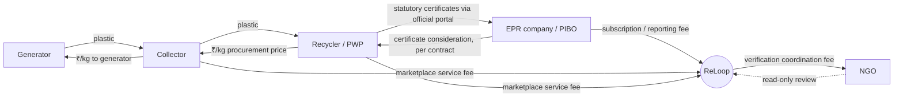

# 02 — Business Model

> All ₹ figures are **[ILLUSTRATIVE]**. No rate is hard-coded. Prices come from offers (05 §4.8).

## 1. Participants and commercial relationships

The relationship between a recycler and an EPR company over statutory certificates happens on the official CPCB system under their own contract. ReLoop records **references** to it and does not intermediate the certificate itself. See 08.

## 2. Financial flow for one batch

[ILLUSTRATIVE] 100 kg PET listed, 98 kg collected, 98 received, 90 accepted.

| Line | Payer → Payee | Basis | Amount |
|---|---|---|---|
| Recycler procurement | Recycler → Collector | 90 accepted kg × ₹10 | ₹900 |
| Generator payment | Collector → Generator | 98 collected kg × ₹8 | ₹784 |
| Collector gross margin | (derived) | ₹900 − ₹784 | ₹116 |
| Platform fee | Collector → ReLoop | e.g. 2% of procurement | ₹18 |
| Collector net | | | ₹98 |

Note how rejection (8 kg) erodes the collector's margin. This is a deliberate incentive for collectors to sort properly. **[ASSUMPTION A-03]** The generator is paid on collected kg, not accepted kg. Alternatives are listed in 14.

## 3. Generator compensation

- Payment = collected kg × the generator rate in the accepted collection offer.
- Optional: contribution certificates (non-statutory, see 07 §8) and brand vouchers (P2).
- Households may opt to donate their payment (P2).

## 4. Collector economics

Margin = recycler price × accepted kg − generator price × collected kg − transport cost − platform fee.

Incentives are commercial only: supply access, posted rates, quick settlement, and a reliability score used in matching. **There are no loyalty points.** A collector can download transaction statements, and these are not rewards.

## 5. Recycler economics

The recycler pays for feedstock that meets its specification, and pays only for accepted kg. Separately, as a registered PWP, it may generate statutory EPR certificates on the official portal and sell them to PIBOs. ReLoop's value to the recycler is better feedstock quality and an organised evidence trail.

## 5a. Cost to the recycler vs what others earn

The landed cost optimiser (10 §4) always separates three views of the same money:

| Perspective | Example: plan B, 560 kg [ILLUSTRATIVE] |
|---|---|
| Recycler's total landed cost | ₹7,060 → ₹14.27 per usable kg |
| Generators receive (Σ payouts) | ₹4,480 |
| Collector expected earnings | ₹1,120 collection charge (less the collector's own transport, if it bears that) |

Transport, sorting, handling and storage go to whoever performs them, as set per offer. The ₹8/₹2 split from the brief remains only an example. Every rate comes from offers and versioned `pricing_assumptions`.

## 6. ReLoop revenue streams

| Stream | Payer | Model [ILLUSTRATIVE] | Phase |
|---|---|---|---|
| Marketplace service fee | Collector and/or recycler | 1–3% of procurement value | MVP |
| EPR dashboard subscription | EPR company | Tiered monthly fee by kg tracked | MVP |
| Evidence reporting | EPR company | Per-report or bundled | MVP |
| Waste coordination services | EPR company / municipal body | Project-based | Later |
| Verification coordination | EPR company (passed through to NGO) | Per-batch or per-period | MVP |
| Procurement intelligence tier (sourcing planner, landed cost, forecasts) | Recycler | Monthly subscription, or included above a volume fee threshold | MVP basic, P1 full |

ReLoop never sells or issues EPR certificates.

## 7. NGO partnership model

- The NGO signs an agreement that defines its **verification scope** (materials, localities, facilities) and its conflict-of-interest declarations.
- Its fee is paid **per review period**, not per VERIFIED decision. This avoids an incentive to approve.
- The NGO may also assess brand partners (see §9).

## 8. EPR corporate customer model

- The EPR company subscribes for visibility, evidence reports and the allocation ledger.
- Statutory obligations, portal filings and certificate purchases remain the company's own responsibility. See 08 §8.

## 9. Brand voucher ecosystem (P2)

- Brands fund vouchers for generators, redeemable at the brand.
- Brand listings must carry specific, substantiated claims (e.g. "30% recycled PET in Product X bottles, NGO-assessed for FY2026-27"). No "100% eco-friendly" claims.
- Voucher eligibility is based on processed (not just collected) kg.
- This must not distract from the EPR-first MVP.
