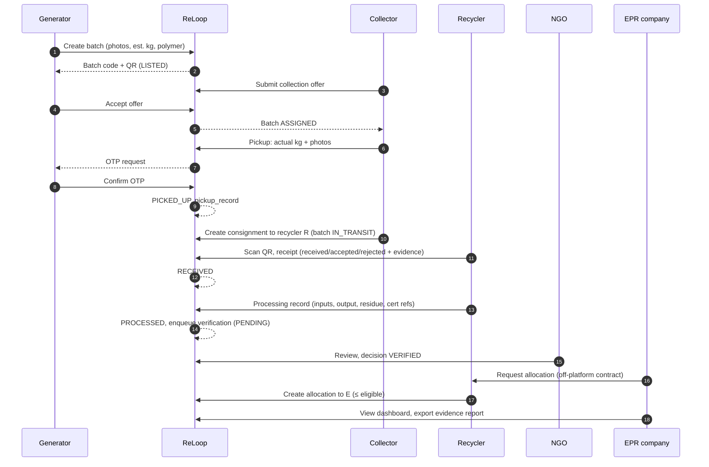
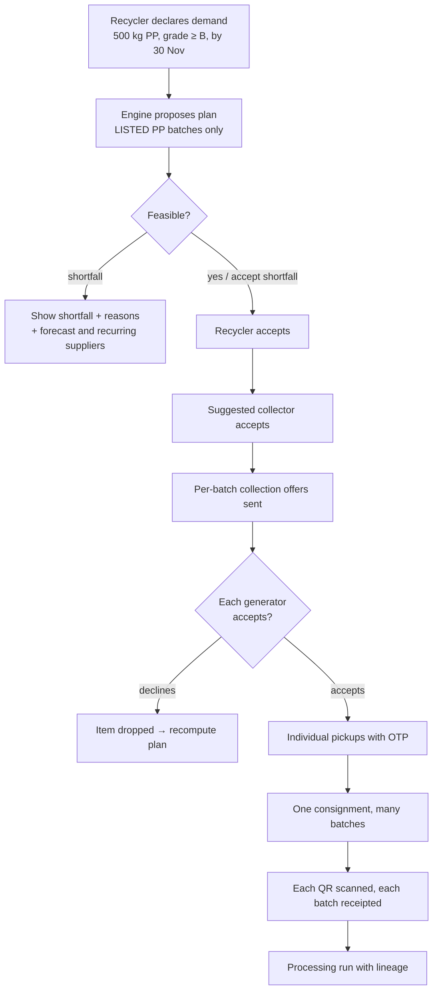
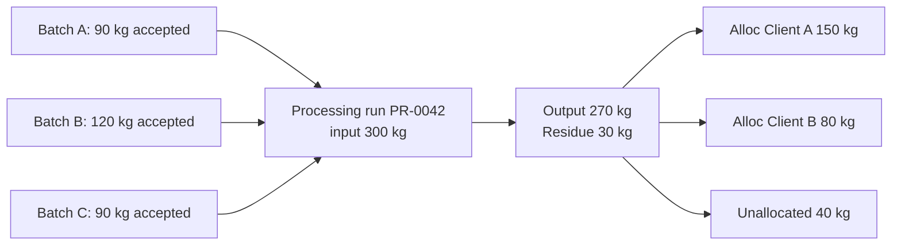
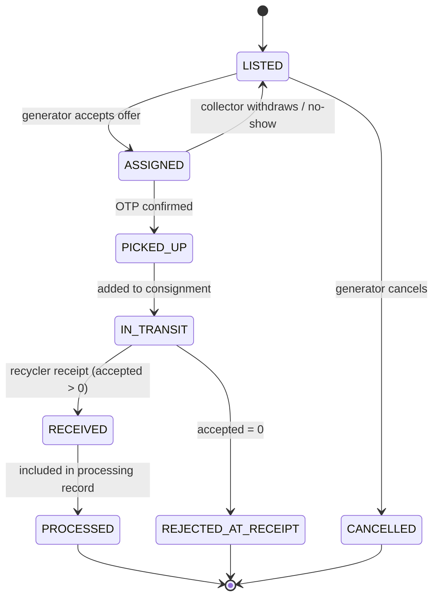

# 03 — End-to-End Workflows

This file owns the **quantity stages** (§2) and **status values** (§6).

## 1. Running example [ILLUSTRATIVE]

Sunrise CHS, Andheri, lists **100 kg PET** (estimate).

| Stage | Who records | kg |
|---|---|---|
| Listed (estimate) | Generator | 100.000 |
| Collected | Collector, with generator confirmation | 98.000 |
| Received | Recycler (weighbridge) | 97.500 |
| Accepted / Rejected | Recycler | 90.000 / 7.500 |
| Processed output | Recycler (processing run) | 82.000 (8.000 residue/loss) |
| NGO-verified | NGO decision on the batch | 82.000 (if VERIFIED), else 0 |
| EPR-allocated | Allocation ledger | e.g. 60.000 to Client A, 22.000 unallocated |

## 2. Quantity stages (canonical)

| Stage | Source of truth (05) | Rule |
|---|---|---|
| Collected | `pickup_records.collected_kg` | May differ from the estimate. A difference over 20% raises a flag |
| Received | `recycler_receipts.received_kg` | Cannot be more than 102% of collected without a flag (weighing tolerance [ASSUMPTION A-07]) |
| Accepted | `recycler_receipts.accepted_kg` | accepted + rejected = received |
| Processed | `processing_records.output_kg`, apportioned per batch via `processing_inputs` | output + residue ≤ input; counts only when `measurement_status = COMPLETE` |
| NGO-verified | Processed kg of batches whose current `ngo_verifications.decision` = VERIFIED | Derived, never stored as editable |
| EPR-allocated | Σ ACTIVE `epr_allocations.quantity_kg` | ≤ `processing_records.eligible_kg` |

**These are never treated as equal.** Dashboards show each one separately.

Two further quantity types sit **outside** the custody ledger and never feed into it:
- **planned kg**, from aggregation plans;
- **predicted kg**, from forecasts.

Planned kg becomes collected kg only through an OTP-confirmed pickup.

## 3. Complete batch lifecycle

## 4. Role workflows

### 4.1 Generator
1. Create a listing, optionally using the AI polymer suggestion (10 §2).
2. Review collector offers, sorted by match score, and accept one.
3. At pickup, check the weight the collector entered and confirm with an OTP or QR.
4. Track the batch status. Receive payment. Download a contribution certificate once the batch is PROCESSED.

### 4.2 Collector
1. Browse available listings within the service area.
2. Send an offer, then wait for acceptance.
3. Pick up, weigh, photograph, and get the generator's OTP.
4. Choose a recycler from the recycler offers that match the material. Load one or more picked-up batches into a **consignment**, which marks them IN_TRANSIT.
5. (Optional) Accept or decline the aggregation plans in which it is the suggested collector.
6. After the recycler issues its receipt, see the settlement amount.

### 4.3 Recycler
1. Configure materials, specifications, capacity and offers.
2. Scan the incoming QR and record the receipt with weighbridge slip and inspection photos.
3. Group received batches into a processing run, then record the output and residue.
4. Attach certificate references (generated by the recycler on the official portal).
5. Respond to NGO correction requests by submitting a **new version** of its record.
6. Create allocations to EPR clients against eligible kg.

### 4.3a Recycler sourcing via an aggregation plan

The plan never creates, merges or edits batches. It only references them.

### 4.4 NGO
See [07_NGO_VERIFICATION_FRAMEWORK.md](07_NGO_VERIFICATION_FRAMEWORK.md).

### 4.5 EPR company
1. Set up the profile: registration number, categories, reporting periods, targets.
2. Monitor allocated, verified and pending quantities.
3. Request allocations from partner recyclers. ReLoop logs the request, and the recycler confirms it.
4. Review discrepancies and NGO flags on allocated quantities.
5. Export the evidence report, then file on the official portal itself.

## 5. Recycler processing with combined batches

Per-batch processed kg is apportioned pro rata: batch A gets 90/300 × 270 = 81 kg. This is a **[DESIGN]** default, open to change ([ASSUMPTION A-10]).

## 6. Status values (canonical)

### 6.1 `waste_batches.status`

### 6.2 `ngo_verifications.decision` (separate axis; see 07)
`PENDING → UNDER_REVIEW → {VERIFIED | FLAGGED | REJECTED | REQUIRES_CORRECTION}`. REQUIRES_CORRECTION leads to resubmission, which goes back to PENDING.

### 6.3 `epr_allocations.status`
`ACTIVE`, `REVERSED`. A reversal is a new row referencing the original. Nothing is updated in place.

## 7. Exception handling

| Exception | Handling |
|---|---|
| Generator disputes the pickup weight | No OTP is given. The batch stays ASSIGNED, and the collector re-weighs or withdraws |
| Collector no-show (window passes plus 24 h) | Auto-revert to LISTED. The miss counts against reliability |
| Received kg ≫ collected kg | Accept with a mandatory note plus an anomaly flag (10 §4) |
| Full rejection | REJECTED_AT_RECEIPT. Material is returned or disposed of as recorded by the recycler. No generator clawback by default ([ASSUMPTION A-04]) |
| NGO REQUIRES_CORRECTION | The recycler/collector submits a new record version. The original is preserved |
| NGO REJECTED after allocation | Allocations stay but are labelled "unverified" on dashboards. Reversal is up to the recycler/client |
| Duplicate certificate reference | Blocked by a unique constraint and flagged |
| Allocation race | Row lock on the processing record (05 §6) |
| Batch claimed by two plans | Blocked (one active plan per batch) |
| Generator declines a plan offer | Item DROPPED, plan recomputed, recycler notified of a new shortfall |
| Combined weight only at receipt | Not permitted in the MVP. Each batch is weighed individually (A-14) |
| Processing output not yet measured | Run stays INCOMPLETE: no yield, no allocation |
| Forecast shortage | Alert only. No automatic procurement |
