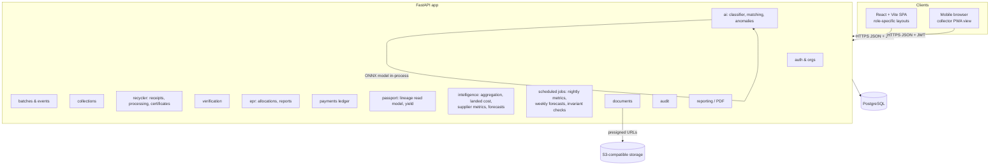
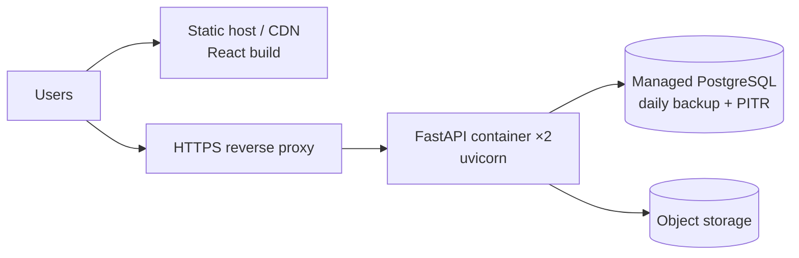

# 04 — System Architecture

## 1. Overview

ReLoop is a **modular monolith**: a single FastAPI deployable with strictly separated internal modules, one PostgreSQL database, and S3-compatible object storage. There are no microservices, no Kafka and no blockchain in the MVP. Tamper-evidence comes from append-only tables and file hashes (11 §7).



## 2. Stack

| Layer | Choice | Notes |
|---|---|---|
| Frontend | React, Vite, TypeScript, Tailwind CSS, Recharts | React Router; TanStack Query for server state |
| QR | `qrcode` (backend, PNG/SVG); `html5-qrcode` or `@zxing/browser` (scan) | QR payload = `https://app.reloop…/b/{batch_code}`, no secrets |
| Backend | Python 3.12, FastAPI, Pydantic v2, SQLAlchemy 2.x, Alembic | |
| DB | PostgreSQL 16 | `NUMERIC` weights/money; row locks for allocation |
| Storage | S3-compatible (AWS S3 / Cloudflare R2 / MinIO locally) | Private bucket, presigned upload/download |
| PDF | WeasyPrint (HTML → PDF) | Reports include file hashes |
| AI | Image classifier exported to ONNX, run in-process with `onnxruntime` | Can move to a worker later |
| Background jobs | FastAPI `BackgroundTasks` for the MVP; later RQ/Celery + Redis | Offer expiry, report generation |

## 3. Backend module layout

```
backend/app/
  core/        config, security (JWT, hashing), db session, permissions
  modules/
    auth/      router.py  schemas.py  service.py  models.py
    orgs/
    batches/
    collections/
    recycler/
    ngo/
    epr/
    payments/
    documents/
    ai/
    passport/      read model over custody tables, snapshots, yield
    intelligence/
      aggregation/ plan proposal (greedy), acceptance state machine
      costing/     landed cost, pricing assumptions
      performance/ supplier indicators (nightly)
      forecasting/ supply/demand forecasts, shortages (weekly)
    consignments/
    audit/
    reports/
```

**Intelligence boundary:** `intelligence/*` may **read** custody data through services and **write only** its own tables (plans, estimates, metrics, forecasts). It acts on custody only through the normal public services, for example by creating collection offers when a plan is activated. It never writes `pickup_records`, `recycler_receipts`, `processing_records` or `epr_allocations` directly, which keeps advisory logic out of the evidence trail.

**Computation:** aggregation and costing are synchronous (under 2 s for ~500 candidates with a greedy algorithm). Metrics and forecasts run as scheduled jobs. In the MVP this is an APScheduler job in the API process (single replica leader via a Postgres advisory lock). Later it moves to the worker queue. The libraries are `numpy`/`pandas` and `scikit-learn` (DBSCAN). OR-Tools is P2.

**Rules:**
- A module may import another module's `service`, never its `models` directly.
- All writes go through services, and services call `audit.record()`.
- Permission checks live in `core/permissions.py` as FastAPI dependencies (11 §4).

## 4. Authentication

- Email/phone and password (argon2). Short-lived access JWT (15 min) plus a refresh token (7 days, rotated, stored hashed).
- JWT claims: `sub` (user_id), `org_id`, `org_type`, `org_role`. These are **always re-checked against the DB** for sensitive writes.
- Pickup handover uses a 6-digit OTP. In the MVP the OTP is shown in the generator's app ([SIMULATED] SMS).

## 5. File storage

1. The client requests `POST /documents/upload-url` and receives a presigned PUT URL plus a `document_id`.
2. The client uploads directly to S3.
3. The client calls `POST /documents/{id}/complete`. The server fetches the object, computes SHA-256, and marks it `READY`.
4. Documents are linked to records by `document_links`. Downloads use short-lived presigned GET URLs after a permission check.

## 6. AI services

Described in 10. All AI runs in-process for the MVP. Every AI call logs its model version and inputs in `ai_predictions`.

## 7. Reporting

Report generation is triggered by the API. It renders an HTML template, converts it to PDF, stores the PDF as a `document` with a hash, and returns a link. Reports are immutable snapshots that record the data timestamp.

## 8. Deployment



- MVP/hackathon: Docker Compose (api, postgres, minio, frontend) on one VM, or a single cloud app instance.
- Environments: `local`, `staging`, `prod`. Alembic migrations run on deploy.

## 9. Evolving without a rewrite

| Pressure | Step |
|---|---|
| Slow reports/AI | Move `reports` and `ai` to a worker queue (Redis + RQ). The API contract is unchanged |
| Read-heavy dashboards | Materialised views or read replica for `epr` and impact queries |
| Heavier optimisation (VRP, ML risk, advanced forecasting) | Move `intelligence/` to workers. Its outputs are already stored with versions, so the API is unchanged |
| Multi-city | Add `city_id` to orgs and batches (reserved now) and partition by city |
| Official portal integration (only if an authorised API exists) | New `integrations/` module behind an interface. No change to the core ledger |
| Module grows large | Its boundary is already clean, so it can be extracted into a service with the same schemas |
