# 05 — Database Design

PostgreSQL 16. This file is the source of truth for tables and columns.

## 1. Conventions

| Item | Convention |
|---|---|
| Primary keys | `id UUID DEFAULT gen_random_uuid()` |
| Human codes | e.g. `batch_code TEXT UNIQUE` (`RL-MUM-2026-000123`) |
| Weights | `NUMERIC(12,3)`, kg, `CHECK (x >= 0)` |
| Money | `NUMERIC(14,2)`, INR |
| Time | `TIMESTAMPTZ`, UTC |
| Enums | PostgreSQL `ENUM` types (or `TEXT` + `CHECK` for flexibility) |
| Soft state | No hard deletes on operational tables. Use `status` and versioning |
| Created/updated | `created_at`, `created_by_user_id` on every table; `updated_at` only where updates are allowed |

## 2. Evaluation of the requested entity list

| Requested | Decision |
|---|---|
| users, organisations | Kept |
| user_roles | Implemented as `org_memberships` (user × org × org_role). The participant type lives on `organisations.org_type`, which avoids a second role table |
| generators, collectors, recyclers, ngos, epr_clients | Kept as **1:1 profile tables** keyed by `org_id`. They hold type-specific fields only, with no duplicated identity columns |
| waste_batches, batch_events | Kept |
| pickup_records, recycler_receipts, processing_records | Kept. Added `processing_inputs` for many-to-one lineage |
| epr_allocations, certificates, ngo_verifications | Kept. `certificates` stores **references** to statutory certificates, not certificates issued by ReLoop |
| payments, documents, audit_logs, material_categories | Kept. Added `document_links` (polymorphic attachment) |
| collection_offers, recycler_offers | Kept |
| Added | `ngo_scopes`, `epr_targets`, `anomaly_flags`, `ai_predictions`, `refresh_tokens` |
| Not created (no delivery table) | Transport is captured by `transport_consignments` plus `batch_events`. A separate delivery table would duplicate the receipt |

### 2.1 Procurement-intelligence entities (suggested list → final decision)

| Suggested | Decision | Why |
|---|---|---|
| recycler_demand_profiles | **Table** | Declared demand is user-entered and durable |
| generator_supply_profiles | **Table** | Declared recurring supply |
| aggregation_plans, aggregation_plan_items | **Tables** | A plan needs acceptance state and per-batch reasons; items reference batches and never copy them |
| transport_consignments | **Table** + `consignment_items` join | Groups batches on one vehicle without merging their identities |
| cost_estimates | **Table** + `pricing_assumptions` (versioned config) | Estimates must be reproducible from the stated assumptions |
| supplier_performance_metrics | **Table** (nightly snapshot) | Shows indicators with n; recomputable from source |
| supply_forecasts, demand_forecasts | **Merged into one `forecasts` table** with `kind` | Identical shape; avoids a duplicate table |
| material_passports | **No table: a read model** (`v_material_passport` view plus PDF snapshots stored as `documents`) | Every field already exists in custody tables; a copy would drift and duplicate the truth |
| processing_runs | **Same as `processing_records`** (the name "processing run" is used in the UI) | Avoids a duplicate table |
| yield_records | **No table: columns on `processing_records`** (`measurement_status`, generated `yield_pct`, `unaccounted_kg`) | Yield is a property of one measured run |

## 3. ER diagram

```mermaid
erDiagram
  users ||--o{ org_memberships : has
  organisations ||--o{ org_memberships : has
  organisations ||--o| generators : profile
  organisations ||--o| collectors : profile
  organisations ||--o| recyclers : profile
  organisations ||--o| ngos : profile
  organisations ||--o| epr_clients : profile
  ngos ||--o{ ngo_scopes : defines
  epr_clients ||--o{ epr_targets : sets
  material_categories ||--o{ waste_batches : classifies
  organisations ||--o{ waste_batches : "generator owns"
  waste_batches ||--o{ batch_events : logs
  waste_batches ||--o{ collection_offers : receives
  organisations ||--o{ collection_offers : "collector makes"
  organisations ||--o{ recycler_offers : "recycler posts"
  waste_batches ||--o{ pickup_records : "versions"
  waste_batches ||--o{ recycler_receipts : "versions"
  recycler_receipts ||--o{ processing_inputs : feeds
  processing_records ||--|{ processing_inputs : consumes
  processing_records ||--o{ certificates : references
  processing_records ||--o{ epr_allocations : "allocated from"
  epr_clients ||--o{ epr_allocations : receives
  certificates ||--o{ epr_allocations : supports
  waste_batches ||--o{ ngo_verifications : reviewed
  ngos ||--o{ ngo_verifications : decides
  waste_batches ||--o{ payments : settles
  documents ||--o{ document_links : attached
  waste_batches ||--o{ anomaly_flags : raises
  users ||--o{ audit_logs : acts
  organisations ||--o{ recycler_demand_profiles : "recycler declares"
  organisations ||--o{ generator_supply_profiles : "generator declares"
  recycler_demand_profiles ||--o{ aggregation_plans : "fulfilled by"
  aggregation_plans ||--|{ aggregation_plan_items : contains
  waste_batches ||--o{ aggregation_plan_items : "referenced by"
  aggregation_plans ||--o| cost_estimates : costed
  pricing_assumptions ||--o{ cost_estimates : parameterises
  transport_consignments ||--|{ consignment_items : carries
  waste_batches ||--o{ consignment_items : "rides in"
  organisations ||--o{ supplier_performance_metrics : measured
  material_categories ||--o{ forecasts : "predicted for"
```



The ER diagram omits the `v_material_passport` view, which is derived from custody tables.

## 4. Tables

### 4.1 Identity
**users**: `id`, `full_name`, `email UNIQUE NULL`, `phone UNIQUE NULL`, `password_hash`, `is_platform_admin BOOL DEFAULT false`, `status (ACTIVE|SUSPENDED)`, `created_at`. CHECK: email or phone is not null.

**organisations**: `id`, `org_type ENUM(GENERATOR,COLLECTOR,RECYCLER,NGO,EPR_CLIENT)`, `legal_name`, `display_name`, `city_id TEXT DEFAULT 'MUM'`, `address`, `lat NUMERIC(9,6)`, `lng NUMERIC(9,6)`, `gstin NULL`, `approval_status ENUM(PENDING,APPROVED,REJECTED,SUSPENDED)`, `created_at`. An org has exactly one type.

**org_memberships**: `user_id FK`, `org_id FK`, `org_role ENUM(OWNER,ADMIN,MEMBER,VIEWER)`. PK `(user_id, org_id)`.

**refresh_tokens**: `id`, `user_id FK`, `token_hash UNIQUE`, `expires_at`, `revoked_at NULL`.

### 4.2 Participant profiles (PK = FK `org_id`)
| Table | Type-specific columns |
|---|---|
| generators | `generator_kind ENUM(HOUSEHOLD,SOCIETY,COMMERCIAL,INSTITUTION,OTHER)`, `payout_upi_ref_masked` |
| collectors | `service_radius_km NUMERIC(5,1)`, `daily_capacity_kg`, `min_pickup_kg`, `vehicle_types TEXT[]`, `reliability_score NUMERIC(4,3)` (derived nightly) |
| recyclers | `pwp_registration_no UNIQUE`, `registration_valid_until DATE`, `spcb ENUM/TEXT` (e.g. MPCB), `processing_type ENUM(RECYCLING, CO_PROCESSING, WASTE_TO_ENERGY, OTHER)`, `monthly_capacity_kg`, `facility_address` |
| ngos | `registration_no`, `registration_type` (Trust/Society/Sec 8), `coi_declaration_doc_id FK documents`, `agreement_valid_until DATE` |
| epr_clients | `epr_registration_no UNIQUE`, `pibo_type ENUM(PRODUCER,IMPORTER,BRAND_OWNER)`, `compliance_contact` |

Recycler-specific acceptance: materials accepted by collectors and recyclers are stored as `collector_materials(org_id, material_category_id)` and the `material_category_id` on recycler offers. These are small join tables, not separate entities.

**ngo_scopes**: `id`, `ngo_org_id FK`, `material_category_id NULL`, `locality TEXT NULL`, `recycler_org_id NULL`, `valid_from`, `valid_to`. NULL means "any".

**epr_targets**: `id`, `epr_org_id FK`, `reporting_period TEXT` (e.g. `FY2026-27`), `packaging_category ENUM(CAT_I,CAT_II,CAT_III,CAT_IV)`, `target_kg NUMERIC(12,3)`, `source_note` (the client's own figure; ReLoop does not compute statutory targets). UNIQUE `(epr_org_id, reporting_period, packaging_category)`.

### 4.3 Reference
**material_categories**: `id SMALLINT`, `code UNIQUE` (PET, HDPE, PVC, LDPE, PP, PS, OTHER, MLP), `resin_code SMALLINT NULL` (1–7), `name`, `default_packaging_category NULL` (an indicative mapping only; see 08 §4).

### 4.4 Batches
**waste_batches**: `id`, `batch_code UNIQUE`, `qr_token UNIQUE` (random 128-bit, URL-safe), `generator_org_id FK`, `material_category_id FK`, `ai_prediction_id NULL FK`, `estimated_kg NUMERIC(12,3) CHECK > 0`, `pickup_address`, `lat`, `lng`, `locality`, `available_from`, `available_to`, `status ENUM` (03 §6.1), `assigned_collector_org_id NULL`, `accepted_offer_id NULL`, `destination_recycler_org_id NULL`, `created_at`.
Indexes: `(status, material_category_id)`, `(generator_org_id)`, `(assigned_collector_org_id)`, `(locality)`, GiST on location if PostGIS is used (P1; the MVP uses a haversine function).

**batch_events** (append-only): `id BIGSERIAL`, `batch_id FK`, `event_type` (CREATED, OFFER_ACCEPTED, PICKED_UP, DISPATCHED, RECEIVED, PROCESSED, CANCELLED, CORRECTION_SUBMITTED, …), `from_status`, `to_status`, `actor_user_id`, `actor_org_id`, `payload JSONB`, `created_at`. Index `(batch_id, created_at)`.

### 4.5 Offers
**collection_offers**: `id`, `batch_id FK`, `collector_org_id FK`, `generator_rate_per_kg NUMERIC(10,2)`, `proposed_pickup_at`, `status ENUM(OPEN,ACCEPTED,DECLINED,EXPIRED,WITHDRAWN)`, `expires_at`. Partial UNIQUE `(batch_id) WHERE status='ACCEPTED'`. UNIQUE `(batch_id, collector_org_id) WHERE status='OPEN'`.

**recycler_offers**: `id`, `recycler_org_id FK`, `material_category_id FK`, `price_per_kg NUMERIC(10,2)`, `min_kg`, `quality_spec TEXT`, `max_contamination_pct NUMERIC(5,2)`, `valid_from`, `valid_to`, `is_active`. The price applied to a receipt is **copied** onto the receipt, so that later edits to the offer do not change history.

### 4.6 Custody records (versioned)
Common versioning columns: `version INT`, `supersedes_id NULL FK self`, `is_current BOOL`, with partial UNIQUE `(batch_id) WHERE is_current`. A correction inserts a new row and flips `is_current`. The old row is never updated otherwise.

**pickup_records**: `id`, `batch_id FK`, `collector_org_id`, `collector_user_id`, `collected_kg CHECK > 0`, `generator_rate_per_kg` (copied from the offer), `handover_method ENUM(OTP,QR)`, `generator_confirmed_by_user_id`, `confirmed_at`, `aggregation_plan_id NULL FK`, `notes`, versioning. (Dispatch is recorded through `transport_consignments`.)

**recycler_receipts**: `id`, `batch_id FK`, `recycler_org_id`, `received_kg`, `accepted_kg`, `rejected_kg`, `quality_grade ENUM(A,B,C)`, `contamination_pct NUMERIC(5,2)`, `price_per_kg` (copied), `recycler_offer_id NULL`, `rejection_disposition TEXT`, `received_at`, versioning.
CHECK `accepted_kg + rejected_kg = received_kg`; all three ≥ 0.

**processing_records**: `id`, `record_code UNIQUE`, `recycler_org_id`, `material_category_id`, `run_started_at`, `run_ended_at`, `input_kg`, `output_kg`, `residue_kg`, `output_form TEXT` (flakes/granules/…), `eligible_kg`, `eligibility_basis TEXT` (the recycler's declaration and certificate link), versioning (keyed by `record_code` lineage instead of `batch_id`).
Yield fields: `output_kg NULL` and `residue_kg NULL` are allowed until measured; `measurement_status ENUM(INCOMPLETE,COMPLETE)` (COMPLETE requires input, output and residue to be non-null); `yield_pct NUMERIC(6,3) GENERATED ALWAYS AS (CASE WHEN measurement_status='COMPLETE' AND input_kg>0 THEN output_kg/input_kg*100 END) STORED`; `unaccounted_kg GENERATED AS (input_kg − output_kg − residue_kg)`.
CHECKs: `output_kg + residue_kg <= input_kg`; `eligible_kg <= COALESCE(output_kg,0)`; all ≥ 0. Allocation is allowed only when `measurement_status = COMPLETE`.

**processing_inputs** (lineage): `processing_record_id FK`, `recycler_receipt_id FK`, `batch_id FK` (denormalised for querying), `input_kg CHECK > 0`, `apportioned_output_kg` (computed: `input_kg / record.input_kg × record.output_kg`, stored on save). PK `(processing_record_id, recycler_receipt_id)`.
Rules: `record.input_kg = Σ processing_inputs.input_kg` (service-enforced and trigger-checked). For each receipt, Σ `input_kg` across current records ≤ `accepted_kg`, which allows one receipt to be split across runs.

### 4.7 Certificates and allocations
**certificates**: `id`, `recycler_org_id FK`, `processing_record_id FK`, `certificate_ref TEXT` (number as issued on the official system), `packaging_category`, `certificate_kg`, `issued_on DATE`, `status ENUM(RECORDED,DISPUTED,WITHDRAWN)`, `evidence_doc_id`.
UNIQUE `(recycler_org_id, certificate_ref)`. CHECK `certificate_kg > 0`. Service check: Σ certificate_kg for a record ≤ `output_kg`.

**epr_allocations** (ledger): `id`, `processing_record_id FK`, `epr_org_id FK`, `certificate_id NULL FK`, `packaging_category`, `reporting_period`, `quantity_kg CHECK > 0`, `status ENUM(ACTIVE,REVERSED)`, `reverses_allocation_id NULL FK self`, `reason TEXT`, `requested_by_user_id`, `created_by_user_id` (recycler), `created_at`.
A reversal sets the original to `REVERSED` (the only permitted update) **and** inserts a row with `reverses_allocation_id`. Both happen in one transaction and both are audited.

### 4.8 Verification, money, documents, audit
**ngo_verifications** (append-only): `id`, `batch_id FK`, `ngo_org_id`, `reviewer_user_id`, `decision ENUM(PENDING,UNDER_REVIEW,VERIFIED,FLAGGED,REJECTED,REQUIRES_CORRECTION)`, `reviewed_record_versions JSONB` (ids and versions of the pickup, receipt and processing records seen), `evidence_doc_ids UUID[]`, `comments`, `follow_up_required TEXT NULL`, `supersedes_id NULL`, `is_current BOOL`, `created_at`. Partial UNIQUE `(batch_id, ngo_org_id) WHERE is_current`.

**payments**: `id`, `batch_id FK`, `payment_type ENUM(GENERATOR_PAYOUT, RECYCLER_PROCUREMENT, PLATFORM_FEE, NGO_FEE, EPR_SUBSCRIPTION)`, `payer_org_id`, `payee_org_id NULL` (null = ReLoop), `quantity_kg NULL`, `rate NULL`, `amount NUMERIC(14,2) CHECK >= 0`, `status ENUM(PENDING,PAID,FAILED,CANCELLED)`, `external_ref NULL`, `created_at`. UNIQUE `(batch_id, payment_type) WHERE status <> 'CANCELLED'` for per-batch types. [SIMULATED] in MVP.

**documents**: `id`, `owner_org_id`, `storage_key`, `mime_type`, `size_bytes`, `sha256 CHAR(64)`, `doc_type ENUM(PHOTO_LISTING, PHOTO_PICKUP, WEIGHBRIDGE_SLIP, INSPECTION, PROCESSING_LOG, CERTIFICATE_COPY, REGISTRATION, REPORT, OTHER)`, `status ENUM(UPLOADING,READY)`, `uploaded_by_user_id`, `created_at`. Index `sha256` (duplicate-image check).
**document_links**: `document_id`, `entity_type`, `entity_id`. PK on all three.

**anomaly_flags**: `id`, `rule_code`, `severity ENUM(INFO,WARN,HIGH)`, `batch_id NULL`, `entity_type`, `entity_id`, `details JSONB`, `status ENUM(OPEN,ACKNOWLEDGED,RESOLVED,DISMISSED)`, `resolved_by_user_id`, `resolution_note`.

**ai_predictions**: `id`, `document_id`, `model_version`, `predicted_code`, `confidence NUMERIC(4,3)`, `top_k JSONB`, `user_confirmed_code`, `created_at`.

**audit_logs** (append-only): `id BIGSERIAL`, `actor_user_id`, `actor_org_id`, `action`, `entity_type`, `entity_id`, `before JSONB`, `after JSONB`, `ip`, `request_id`, `created_at`, `prev_hash CHAR(64)`, `row_hash CHAR(64)` (hash chain; see 11 §7). The app DB role has INSERT/SELECT only.

### 4.9 Procurement intelligence

**pricing_assumptions** (versioned config): `id`, `scope_org_id NULL` (null = platform default), `version`, `transport_per_km`, `transport_per_kg_km`, `sorting_per_kg`, `handling_per_kg`, `storage_per_kg_day`, `default_rejection_rate JSONB` (per material), `default_process_loss_rate JSONB`, `rejection_cost_per_kg`, `effective_from`, `is_active`. Rows are immutable; a change creates a new version.

**recycler_demand_profiles**: `id`, `recycler_org_id FK`, `material_category_id FK`, `recurrence ENUM(ONE_OFF,WEEKLY,MONTHLY)`, `quantity_kg`, `min_lot_kg`, `min_quality_grade`, `max_contamination_pct`, `period_start`, `period_end`, `need_by DATE`, `current_inventory_kg NULL`, `storage_headroom_kg NULL`, `target_landed_cost_per_kg NULL`, `status ENUM(ACTIVE,PAUSED,CLOSED)`.

**generator_supply_profiles**: `id`, `generator_org_id FK`, `material_category_id FK`, `recurrence ENUM(WEEKLY,FORTNIGHTLY,MONTHLY)`, `typical_kg`, `preferred_weekday SMALLINT NULL`, `pickup_window TEXT`, `is_active`. *Declared supply, not inventory.*

**aggregation_plans**: `id`, `plan_code UNIQUE`, `recycler_org_id FK`, `demand_profile_id NULL FK`, `material_category_id FK`, `target_kg`, `suggested_collector_org_id NULL`, `est_total_kg`, `est_usable_kg`, `fulfils_requirement BOOL`, `shortfall_kg`, `cost_estimate_id FK`, `status ENUM(DRAFT,PROPOSED,ACCEPTED,ACTIVE,COMPLETED,CANCELLED)`, `recycler_accepted_by NULL`, `recycler_accepted_at`, `collector_accepted_by NULL`, `collector_accepted_at`, `explanation JSONB`, `excluded JSONB`, `algorithm_version`, `assumptions_version`, `created_at`.
CHECK: status `ACCEPTED`/`ACTIVE` requires both acceptances.

**aggregation_plan_items**: `plan_id FK`, `batch_id FK`, `sequence_no`, `planned_kg`, `est_usable_kg`, `distance_km`, `reasons JSONB`, `item_status ENUM(PROPOSED,GENERATOR_ACCEPTED,DECLINED,COLLECTED,DROPPED)`. PK `(plan_id, batch_id)`.
Constraints: `planned_kg <= waste_batches.estimated_kg` (trigger); a batch may sit in **at most one** plan whose status is in (PROPOSED, ACCEPTED, ACTIVE) (trigger plus a `active_plan_id` column on `waste_batches` with an FK); material must equal the plan's material (trigger). A plan only ever references batches; it never creates or merges them.

**transport_consignments**: `id`, `consignment_code UNIQUE`, `collector_org_id`, `destination_recycler_org_id`, `aggregation_plan_id NULL`, `vehicle_no`, `dispatched_at`, `arrived_at NULL`, `status ENUM(LOADING,IN_TRANSIT,ARRIVED,CLOSED)`.
**consignment_items**: `consignment_id FK`, `batch_id FK UNIQUE` (a batch rides in exactly one consignment per trip; a re-dispatch after rejection creates a new consignment with a new version, MVP rare case). Each batch is still received with its own `recycler_receipt`.

**cost_estimates**: `id`, `subject_type ENUM(PLAN,BATCH,COMPARISON)`, `subject_id`, `recycler_org_id`, `assumptions_id FK pricing_assumptions`, `est_kg`, `expected_rejection_kg`, `expected_process_loss_kg`, `expected_usable_kg`, `generator_payment`, `collector_charge`, `transport_cost`, `sorting_cost`, `handling_cost`, `storage_cost`, `rejection_cost`, `total_cost`, `landed_cost_per_usable_kg`, `generator_receives`, `collector_expected_earnings`, `transport_borne_by ENUM(COLLECTOR,RECYCLER)`, `breakdown JSONB`, `created_at`. CHECK `total_cost = sum of cost lines` (to 0.01).

**supplier_performance_metrics**: `id`, `org_id FK`, `role ENUM(GENERATOR,COLLECTOR)`, `material_category_id NULL`, `window ENUM(D180,ALL)`, `n_transactions`, `fulfilment_rate`, `on_time_rate`, `weight_discrepancy_pct`, `rejection_rate`, `contamination_rate`, `completion_rate` (all NULL when n < 5), `history_level ENUM(INSUFFICIENT,LIMITED,SUFFICIENT)`, `computed_at`. UNIQUE `(org_id, role, material_category_id, window)`.

**forecasts**: `id`, `kind ENUM(SUPPLY,DEMAND)`, `org_id NULL`, `locality NULL`, `material_category_id`, `period_start`, `period_end`, `predicted_kg`, `lower_kg`, `upper_kg`, `method`, `n_history_points`, `confidence_label ENUM(LOW,MEDIUM,HIGH)`, `generated_at`. **No FK from any custody or allocation table points here.**

### 4.10 Material passport (read model)

`v_material_passport` is one row per batch, plus nested JSON. It joins: batch identity and QR, generator and location, polymer (declared, AI suggestion, recycler-confirmed), estimate, current and previous pickup versions, consignment(s), current and previous receipt versions, processing record(s) through `processing_inputs` (input kg, apportioned output, run yield, measurement status), certificate references, the full NGO decision history, the allocation history (including reversals), documents with SHA-256, and open anomaly flags.

- `GET /passports/{batch_code}` renders it. `POST /passports/{batch_code}/snapshot` stores an immutable PDF/JSON as a `document` with its hash.
- Visibility is filtered per role (11 §3). For example, an EPR client sees generator identity only as locality and generator type, unless consent is given (11 §5).

## 5. Batch lineage

The path is batch → current pickup → current receipt → `processing_inputs` → processing record → certificates / allocations. For any allocation, the source batches and generators are found by joining `processing_inputs`. For any batch, the share of each allocation is:

`batch_share = processing_inputs.apportioned_output_kg / processing_records.output_kg`

**[DESIGN]** Batch-level attribution of an allocation (e.g. "Batch A contributed 81/270 of Client A's 150 kg") is **pro rata and informational**. Statutory attribution happens at the certificate level on the official system ([ASSUMPTION A-10]).

## 6. EPR allocation without double counting

Invariant: for each processing record,
`Σ quantity_kg of ACTIVE allocations ≤ eligible_kg` (and, where `certificate_id` is set, `≤ certificate_kg` per certificate).

Enforcement has three layers:

1. **Service transaction** (primary):
```sql
BEGIN;
SELECT eligible_kg FROM processing_records WHERE id = :pr AND is_current FOR UPDATE;
SELECT COALESCE(SUM(quantity_kg),0) FROM epr_allocations
  WHERE processing_record_id = :pr AND status = 'ACTIVE';
-- if allocated + :qty > eligible → raise 409 ALLOCATION_EXCEEDS_AVAILABLE
INSERT INTO epr_allocations (...) VALUES (...);
INSERT INTO audit_logs (...);
COMMIT;
```
2. **Constraint trigger** (backstop): `AFTER INSERT OR UPDATE ON epr_allocations DEFERRABLE INITIALLY DEFERRED` re-checks the sum and raises an exception.
3. **Certificate uniqueness:** UNIQUE `(recycler_org_id, certificate_ref)` stops the same statutory certificate being recorded twice on ReLoop. Cross-platform duplicates cannot be detected; see 08 §9.

Lowering `eligible_kg` below the allocated sum via a new processing-record version is blocked with 409 until allocations are reversed.

## 7. Audit and history strategy

| Mechanism | Used for |
|---|---|
| Append-only event tables | `batch_events`, `ngo_verifications`, `audit_logs` |
| Versioned rows (`supersedes_id`, `is_current`) | pickup, receipt, processing records |
| Ledger with reversal rows | `epr_allocations`, `payments` |
| DB grants | App role: no `DELETE` on any operational table; no `UPDATE` on append-only tables |
| Hash chain plus file SHA-256 | Tamper evidence (11 §7) |

## 8. Key indexes (in addition to PK/UNIQUE)

`waste_batches(status, material_category_id)`, `waste_batches(generator_org_id, created_at DESC)`, `collection_offers(batch_id, status)`, `recycler_receipts(recycler_org_id, received_at)`, `processing_inputs(batch_id)`, `epr_allocations(epr_org_id, reporting_period, status)`, `epr_allocations(processing_record_id, status)`, `ngo_verifications(ngo_org_id, decision) WHERE is_current`, `anomaly_flags(status, severity)`, `audit_logs(entity_type, entity_id)`.
