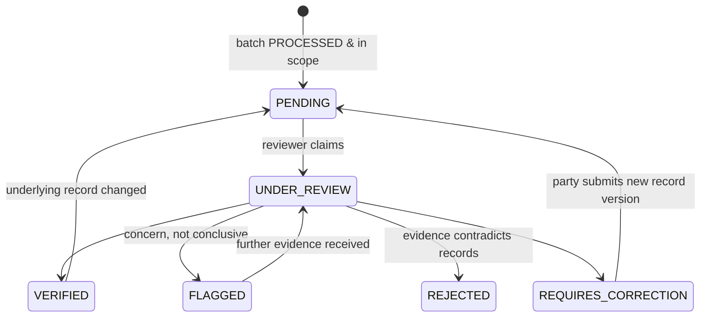

# 07 — NGO Verification Framework

## 1. Purpose and boundary

The NGO provides **independent supporting evidence** that a batch's chain of custody and quantities are internally consistent and backed by evidence. An NGO decision:

- **is** an independent review recorded by a named reviewer;
- **is not** a statutory EPR certificate, a CPCB/SPCB authorisation, or a legal determination of EPR eligibility [REG boundary, see 08 §8];
- **cannot** change any operational record.

## 2. Onboarding

1. The NGO registers (org_type `NGO`) and uploads its registration certificate (Trust/Society/Section 8), a profile of its verification team, and a **conflict-of-interest declaration**.
2. A platform admin reviews the documents and signs the verification agreement offline. The agreement defines the scope, fee model (per period, not per approval; see 02 §7), and term.
3. The admin creates `ngo_scopes` rows covering materials, localities and recycler facilities.
4. Reviewers are added as org members with the MEMBER role. Each decision records `reviewer_user_id`.

**Conflict rule [DESIGN]:** an NGO cannot review batches involving an org listed in its COI declaration (`ngo_conflicts(ngo_org_id, org_id)`). The API returns 403 `NGO_CONFLICT_OF_INTEREST`.

## 3. Independence controls

| Control | Mechanism |
|---|---|
| Cannot edit operational data | Permission guard on `org_type=NGO`, plus no NGO code path in write services |
| Cannot rewrite its own history | `ngo_verifications` is append-only. A new decision supersedes the old one, and both are visible |
| Sees originals and changes | The detail view shows all versions of the pickup, receipt and processing records, with diffs |
| Decision tied to what was seen | `reviewed_record_versions` snapshot. If a record changes after VERIFIED, the batch automatically gets a new PENDING entry |
| Accountability | Named reviewer, timestamp, evidence list, audit log |
| Two-person rule (P1) | Optional: VERIFIED decisions above X kg need a second reviewer's countersignature |

## 4. Queue entry

A batch enters an NGO's queue (decision PENDING) when its status becomes PROCESSED **and** it matches one of the NGO's scopes. If several NGOs match, the MVP assigns it round-robin to one NGO ([ASSUMPTION A-12]). A queue item can also be created by sampling, for example 100% of batches above 500 kg plus a 20% random sample of the rest (P1, [ASSUMPTION A-13]).

## 5. Workflow

Each arrow inserts a new `ngo_verifications` row. "Current" means the latest row.

## 6. Evidence checklist

| # | Check | Pass criterion [DESIGN default] |
|---|---|---|
| 1 | Listing photo present and consistent with the declared polymer | Present |
| 2 | Pickup photo plus generator OTP/QR confirmation | Both present |
| 3 | Collected vs estimated | Within ±20% or explained |
| 4 | Received vs collected | Received ≤ collected × 1.02 and ≥ collected × 0.90, or explained |
| 5 | accepted + rejected = received | Exact (DB-enforced) |
| 6 | Weighbridge slip or inspection record | Present, file hash recorded |
| 7 | Processing record includes this batch; output + residue ≤ input | DB-enforced, viewed |
| 8 | Recycler registration number present and not past `registration_valid_until` | Valid on the processing date |
| 9 | Certificate references (if any) link to this recycler and record | Matches |
| 10 | Open anomaly flags | Reviewed and commented |
| 11 | Run measurement status COMPLETE; yield and mass balance plausible for the material | Unaccounted ≤ 3% or explained |
| 12 | If the batch came via an aggregation plan or consignment, it was received and weighed individually | Own receipt present |
| 13 | Timeline plausibility (pickup → receipt → processing order and gaps) | Ordered; gaps explained |

## 7. Discrepancy management

- FLAGGED or REJECTED decisions create or update `anomaly_flags` and notify the responsible party and affected EPR clients (03 §7).
- A document request (`/ngo/verifications/{id}/document-requests`) notifies the party, who uploads evidence and links it to the record. Nothing is edited.
- Discrepancies show on the EPR dashboard as "allocated – not verified".

## 8. Reports

- **Verification report (PDF):** period, scope, batches reviewed, decisions by type, kg by decision, sampled vs full review, reviewer names, exceptions, and the hash of each evidence file. The footer states the boundary in §1.
- **Generator contribution certificate:** issued by ReLoop, showing processed kg, with "independently reviewed by <NGO>" only for VERIFIED kg. Non-statutory.

## 9. Limitations

- The NGO reviews digital evidence. It does not physically witness every weighing. Physical spot audits are P1 and depend on the agreement.
- Image evidence can be staged. Duplicate-hash and timing checks reduce this risk but do not eliminate it.
- Independence depends on the agreement and the fee structure, not on software alone.
- An NGO decision has no statutory force. An EPR client must not present it as a CPCB certificate.
