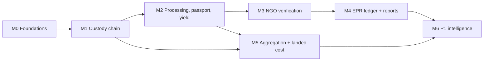

# 12 — Development Roadmap

**Rule:** the core traceability → NGO → EPR allocation path ships first. Intelligence features must never block it.

## 1. Priorities (consolidated)

| P0 (MVP) | P1 | P2 |
|---|---|---|
| Auth, orgs, roles | AI plastic identification | Brand voucher marketplace |
| Batch, QR, events | Smart collector matching | Advanced rewards (generators only) |
| Collection offers, pickup + OTP, consignments | Material and capacity management | VRP route optimisation |
| Recycler receipt, processing runs | Certificate reference management (full) | Predictive rejection-risk ML |
| **Material passport and batch lineage** | Advanced reporting | Advanced forecasting |
| **Measured yield and mass balance** | Anomaly detection rules | Automated procurement recommendations |
| NGO verification + audit trail | **Supplier performance indicators** | Official portal integration (only if authorised) |
| EPR dashboard, allocation safeguards, evidence report | **Recycler demand profiles** | Multi-city |
| **Basic feedstock aggregation (greedy)** | **Generator supply profiles** | |
| **Basic landed cost calculation** | **Basic supply/demand forecasting + shortage alert** | |

## 2. Milestones and sequence

| M | Scope | Depends on | Exit criteria |
|---|---|---|---|
| M0 | Repo, Docker Compose, CI, Alembic, auth, orgs, documents/S3, audit hash chain | — | Login per role; upload with hash |
| M1 | Batches, QR, offers, pickup OTP, consignments, receipts | M0 | Batch reaches RECEIVED with all six stages visible so far |
| M2 | Processing runs with `processing_inputs`, measurement status, yield, material passport view and snapshot | M1 | Combined run of 3 batches; passport shows pro-rata attribution; incomplete run shows no yield |
| M3 | NGO scopes, queue, decisions, document requests, report | M2 | Independence tests pass (§4) |
| M4 | Certificates, allocations with lock and trigger, EPR dashboard, evidence PDF | M2, M3 | Concurrency test: no over-allocation |
| M5 | Demand profile (minimal), pricing assumptions, cost estimate and compare, greedy aggregation plan with dual acceptance | M1, M2 (yield priors) | 500 kg PP plan from ≥ 10 listings, no mixed materials, identities preserved through receipt |
| M6 | Performance metrics, supply profiles, forecasts, shortage alerts, matching, AI classifier, anomalies | M4, M5 | Indicators show n; forecast vs confirmed separated |

M5 can run in parallel with M3/M4 if a second developer is available. Otherwise it comes after M4.

## 3. Testing requirements

- **Unit:** quantity validators, cost formula (total = Σ lines; ₹/usable kg), yield (null when incomplete), aggregation hard rules, metric thresholds by n.
- **Integration:** full lifecycle, correction/versioning, NGO supersession, plan acceptance and decline, consignment with 5 batches and per-batch receipts.
- **Permission tests:** generated from the matrix (11 §3). Every cell marked "—" must return 403/404.
- **Concurrency:** 50 parallel allocation requests against one run, and a batch placed into two plans in parallel.
- **Invariant checks (nightly SQL):** Σ allocations ≤ eligible; Σ plan kg ≤ source estimates; no batch in two active plans; no forecast referenced by a ledger; audit chain intact.

## 4. Demo requirements ([SIMULATED] vs real)

| Item | Demo | Needs in reality |
|---|---|---|
| Users and orgs | Seeded: 30 generators, 3 collectors, 2 recyclers, 1 NGO, 2 EPR clients (fictional names) | Real onboarding and KYC |
| Recycler PWP registration | Fake numbers, labelled "DEMO" | Valid CPCB registration |
| Certificates | Fake references | Generated by the PWP on the CPCB portal |
| Payments | Ledger only | Payment gateway, KYC, tax |
| SMS OTP | Shown in-app | SMS provider |
| Forecasts | 26 weeks of synthetic history | Real history (≥ 1 year for seasonality) |
| AI classifier | Pretrained on public data | Local validation dataset |

## 5. Future scope
Multi-city partitioning, municipal (ULB) dashboards, NIR-sensor integration at recyclers, portal integration only through an official authorised interface, and a mobile native app for collectors.
