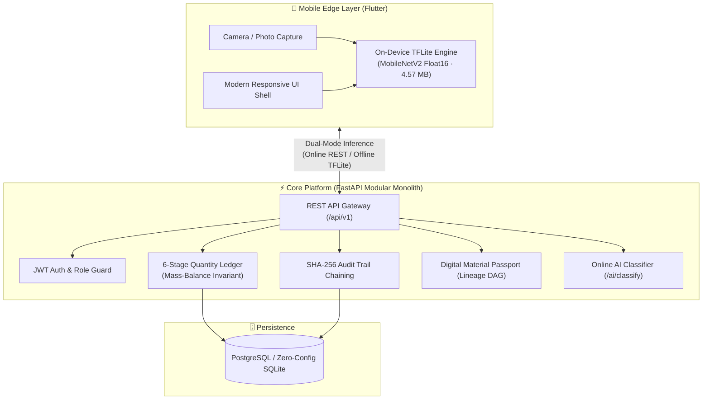

# ReLoop – Circular Plastics Traceability & Statutory EPR Platform

[](https://fastapi.tiangolo.com)
[](https://flutter.dev)
[](https://tensorflow.org/lite)
[](https://vitejs.dev)
[](https://python.org)
[](#-testing--verification)

**ReLoop** is an end-to-end circular plastics marketplace and statutory Extended Producer Responsibility (EPR) traceability platform designed for Indian urban waste ecosystems (pilot: Mumbai). It connects all participants around a single, cryptographically tracked unit—the **waste batch**—enforcing mass-balance conservation, immutable custody lineage, zero double-counting safeguards, and real-time on-device Edge-AI plastic waste classification.

---

## 🏗️ System Architecture



---

## 🤖 Real-Time On-Device AI Waste Classifier

ReLoop features a lightweight, high-accuracy computer vision model running directly on edge devices (Android / iOS) without requiring an internet connection.

- **Architecture:** MobileNetV2 with Float16 quantization (~4.57 MB `.tflite`).
- **Dataset:** Trained on real-world plastic waste images across 8 target classes:
  - `PET` (Polyethylene Terephthalate — Bottles, containers)
  - `HDPE` (High-Density Polyethylene — Milk jugs, detergent bottles)
  - `PVC` (Polyvinyl Chloride — Pipes, rigid packaging)
  - `LDPE` (Low-Density Polyethylene — Bags, wraps)
  - `PP` (Polypropylene — Caps, tubs, food containers)
  - `PS` (Polystyrene — Foam trays, cutlery)
  - `OTHER` (Mixed / Multi-layer packaging)
  - `NOT_PLASTIC` (Contamination / Non-plastic waste)
- **CPCB Regulatory Alignment:** Automatically maps predictions to Indian Central Pollution Control Board (CPCB) EPR categories:
  - **Category I:** Rigid plastic packaging
  - **Category II:** Flexible plastic packaging of single-layer / multi-layer
  - **Category III:** Multi-layered plastic packaging (at least one plastic layer + non-plastic)
  - **Category IV:** Plastic sheet or compostable plastic
- **Dual-Mode Inference Engine:** When connected, the app queries `POST /api/v1/ai/classify` on the backend. If offline or in low-connectivity collection yards, it automatically falls back to instant local on-device TFLite inference.

---

## 🚀 Quick Start

### 1-Click Launchers (Windows)
| Script | Description |
|---|---|
| [`run_backend.bat`](run_backend.bat) | Launches the FastAPI server with auto-reload on `http://localhost:8000` |
| [`run_physical_phone.bat`](run_physical_phone.bat) | Connects via ADB, configures port forwarding (`localhost:8000`), and launches Flutter on your phone |
| [`connect_wireless.bat`](connect_wireless.bat) | Guided wireless pairing and connection wizard for Android devices |
| [`run_webapp.bat`](run_webapp.bat) | Starts the React Vite frontend on `http://localhost:5173` |

---

### Manual Setup & Execution

#### 1. Prerequisites
- **Python:** 3.12+ (virtual environment located in `backend/.venv`)
- **Flutter:** 3.29+ / Dart 3.7+ (`C:\App Devlopment\flutter\bin\flutter.bat`)
- **Node.js:** 20+ / 22+ (for frontend)
- **Android SDK:** Platform tools (`adb`) for physical device debugging

#### 2. Backend (FastAPI)
```powershell
cd backend
.\.venv\Scripts\Activate.ps1
uvicorn app.main:app --host 0.0.0.0 --port 8000 --reload
```
- **Interactive Swagger Docs:** [http://localhost:8000/docs](http://localhost:8000/docs)
- **Health Check:** [http://localhost:8000/health](http://localhost:8000/health)
- *(Runs on zero-config local SQLite `reloop.db` or PostgreSQL if `DATABASE_URL` is set in `.env`)*

#### 3. Seed Demo Data (Optional)
To populate realistic Mumbai batches, transactions, users, and audit chains:
```powershell
cd backend
.\.venv\Scripts\python.exe seed_data.py
```

#### 4. Mobile App (Flutter)
```powershell
cd mobile

# Run on physical connected Android phone
flutter run -d <device_id>

# Run on Windows Desktop
flutter run -d windows

# Run on Chrome Web
flutter run -d chrome
```

---

## 👥 Demo Personas & Logins

All demo accounts share the password: **`reloop123`**

| Role | Organisation | Demo Email | Capabilities in App |
|---|---|---|---|
| **Generator** | Godrej Green Towers CHS | `generator@reloop.in` | List waste, AI polymer detection, accept collector bids, verify handovers with 6-digit OTP |
| **Collector** | Dharavi Waste Collectors Society | `collector@reloop.in` | Browse listings, submit per-kg offers, record scale weights & OTP, build multi-batch consignments |
| **Recycler** | Ecoplas Circular Solutions Ltd | `recycler@reloop.in` | Inbound weighbridge receipts (`accepted + rejected = received`), log processing runs, calculate yield, allocate EPR output |
| **NGO Auditor** | Green Ledger Foundation India | `ngo@reloop.in` | Review immutable digital custody chains, check weighbridge slips, make statutory verification decisions (`VERIFIED` / `FLAGGED`) |
| **EPR Brand** | Hindustan Consumer Goods Ltd | `epr@reloop.in` | Track Cat-I to Cat-IV compliance targets vs verified allocated kilograms, export audit dossiers |
| **Admin** | ReLoop Governance Ops | `admin@reloop.in` | Platform telemetry, audit trail SHA-256 hash validation, organization onboarding & approvals |

> [!TIP]
> **1-Tap Role Switcher:** You can jump between any of the 6 roles instantly via the avatar menu in the top-right corner of the app, or click the quick-login persona buttons on the sign-in screen.

---

## 📂 Repository Structure

```
LYB/
├── backend/                  # FastAPI Modular Monolith Backend
│   ├── app/
│   │   ├── core/             # Database, config, security, permissions
│   │   ├── modules/          # Domain modules (batches, auth, ai, recycler, ngo, epr, etc.)
│   │   │   └── ai/           # Image classification service (Keras & TFLite integration)
│   │   └── main.py           # Application entrypoint & lifespan
│   ├── seed_data.py          # Demo dataset generator
│   └── test_api_suite.py     # Comprehensive automated API tests
│
├── mobile/                   # Unified Flutter Multi-Platform App (Android, iOS, Web, Desktop)
│   ├── assets/models/        # plastic_classifier.tflite (4.57MB) and labels.txt
│   ├── lib/
│   │   ├── core/             # API client, JWT auth, query cache, roles, formats
│   │   ├── features/         # On-device TFLite classifier, AI detect panel, material passport
│   │   ├── pages/            # Role workspaces (generator, collector, recycler, ngo, epr, admin)
│   │   ├── shell/            # Responsive app shell, top bar, navigation drawer
│   │   └── ui/               # Design system widgets, KPI grids, charts, states
│   └── test/                 # 155 unit, route, and responsive layout smoke tests
│
├── frontend/                 # React 19 + Vite + Tailwind Web Application
├── ml/                       # Machine Learning Training Pipeline
│   ├── train.py              # MobileNetV2 fine-tuning and TFLite quantization pipeline
│   └── output/               # Trained models (.tflite, .keras) and labels
├── Docs/                     # Statutory framework, API specs, and product documentation
├── .gitignore                # Production git ignore (excludes raw datasets, build artifacts, venvs)
└── README.md                 # Project documentation (this file)
```

---

## 🧪 Testing & Verification

### Mobile App Test Suite (155 Tests)
The mobile test suite runs static analysis, unit logic tests, and responsive layout tests at **390×844 (phone)** and **1400×900 (desktop)** viewports:
```powershell
cd mobile
flutter analyze                       # Must report 0 issues
flutter test                          # Runs all 155 unit & responsive smoke tests
```

### Backend API Test Suite
```powershell
cd backend
.\.venv\Scripts\python.exe test_api_suite.py
```

---

## 🛡️ Statutory EPR Compliance & Safeguards

1. **Mass-Balance Law Enforcement:**
   $$\text{Received kg} = \text{Accepted kg} + \text{Rejected kg}$$
   $$\text{Processing Input kg} = \text{Recovered Output kg} + \text{Residue kg} + \text{Process Loss}$$
2. **Anti-Double-Counting Invariant:**
   $$\sum \text{Active Allocations} \le \text{Verified Eligible Output kg}$$
   Enforced at the database level with serializable concurrency locks (`HTTP 409 CONFLICT`).
3. **Independent NGO Verification Barrier:**
   NGOs operate as read-only evidentiary auditors. An NGO decision (`VERIFIED` or `FLAGGED`) attaches an independent digital attestation without mutating custody records.
4. **Cryptographic Audit Log:**
   Every custodial state transition and gate inspection is recorded in a hash-chained audit log where:
   $$\text{Hash}_n = \text{SHA-256}(\text{Hash}_{n-1} \parallel \text{Payload}_n)$$
